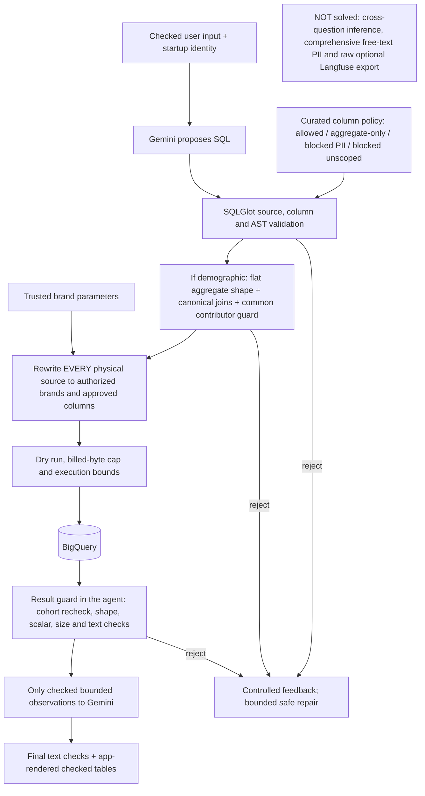

# Query safety: unified SQL, structural checks and bounded repairs

## Decision

Model actions are `query`, `report`, `remember`, `answer`. The model writes SQL for BOTH
ordinary and demographic analytics. A separate typed demographic tool with fixed
dimensions was considered and rejected: every new business grouping would need a
code change. Demographic privacy is enforced on the SQL itself instead (below).
Explicit owner-scoped operator memory is documented separately in USER_MEMORY.md;
it is not a route to customer PII, authorization changes or tool-policy overrides.

For example, five-year intervals use `FLOOR(u.age/5)*5` and `...+4` in GROUP BY.
Ten-year intervals, CASE-based dimensions, rounding and ratios of approved
aggregates do not need new request fields.

## Safety layers

## Shared SQL boundary

`sql/validator.py` parses one read-only SELECT/set query, qualifies columns
against the policy catalog using SQLGlot and rejects unknown sources, direct PII
anywhere, DML/DDL, wildcard projections, external/UDF/identity functions, custom
parameters and unsupported source modifiers. Aliases do not change column policy.
`orders.num_of_item` has the `blocked_unscoped` policy because a whole-order
count can include unauthorized brands; the catalog, not special cases, blocks it.

`sql/scope.py` replaces every physical source with an authorized-brand
relation, including sources inside ordinary CTEs/subqueries. Only approved source
columns are projected; aggregate-only columns are included only after demographic
shape validation succeeds. Brand ARRAY parameters come from trusted identity,
not model text. A visible customer does not unlock their other purchases.

## Demographic SQL: supported shape, not unrestricted SQL

`sql/demographics.py` (`DemographicQuery`) applies when any source column is AGGREGATE_ONLY:

- One flat aggregate SELECT; no CTEs/subqueries/set operations/windows, grouping
  sets/rollups or SELECT DISTINCT in this subset.
- Exactly users + order_items, optionally products, each once, connected by
  canonical INNER JOIN equality keys. Other filters belong in WHERE.
- Grouping/filter expressions may reference demographic attributes, product
  fields and approved purchase facts, not individual customer/order/item IDs.
- Outputs must be grouped expressions or expressions over approved aggregates.
  COUNT([DISTINCT] direct column), SUM/AVG/MIN/MAX of approved numeric inputs and
  reviewed arithmetic are supported. Conditional/nested aggregates fail closed.
- Identifier columns may be used for canonical joins and direct counts, never
  to target/filter one individual inside a metric or expose their profile.
- The internal cohort output name is reserved for trusted code.

The model chooses expressions and business intent; code enforces this structural
subset. Complex rejected SQL is an implementation limitation, not necessarily a
stakeholder prohibition. It must be explained honestly, not replaced with a
different analysis while claiming success.

## Contributor guard and result boundary

Trusted code adds COUNT(DISTINCT buyer) plus HAVING >= k BEFORE ORDER/LIMIT.
The common contributor set requires non-null aggregate arguments AND their input
columns. This prevents a large otherwise-null group publishing one known age.
Counted buyers must belong to the actual canonically joined purchases.
ResultGuard rechecks the service-owned counter, removes it, validates expected
columns/scalar types/finite values and bounds the observation before Gemini.

The default k=5 (CLI minimum 2) is a configurable prototype choice, not a client-
mandated number. It applies to demographic queries only. Empty output can mean
no data OR suppression; rankings include publishable groups only. Do not sum
overlapping group buyer counts or reconstruct suppressed bins from partial rows.

AVG(users.age) over purchase joins is PURCHASE-WEIGHTED (each purchase counts),
not a distinct-buyer mean; this is stated in the model instructions and in the
observation context. No universal metric correctness is claimed.

## Two automatic repairs

SQL validation/BigQuery rejection feedback includes controlled reasons and bounded
previous SQL. Three consecutive SQL failures means initial attempt plus TWO
automatic repair attempts in the SAME user turn. A premature final answer after
failed SQL gets a bounded correction prompt rather than asking the user to retry.
Malformed JSON/action responses get up to TWO corrections before any tool runs;
raw invalid values/provider bodies are not echoed. All steps remain inside the
7-model-call, 5-SQL-attempt and scan budgets. Authorization failures, unsafe
results, ambiguous timeouts and unavailable/rate-limited services are not blindly
replayed. Report writes/deletion are not automatically retried.

Pre-execution authorization/validation/dry-run failures do not consume scan
allowance. Executions with unknown billing conservatively reserve their ceiling.
Per-query limits still apply (dry run, billed bytes, rows, response size, timeout).
These controls are not an account-wide cost cap or end-to-end deadline.

## Why basic aggregate checks are insufficient (examples)

Blocked by this implementation:
- `AVG(age) WHERE id=123`: an aggregate still reveals one person's age.
- `SUM(CASE WHEN id=123 THEN age ELSE 0 END)` alongside a large COUNT: the group
  count says nothing about who actually contributes to the sensitive metric.
- `GROUP BY user_id`, encoded/renamed ID outputs and demographic-filtered ID
  lists: column names/aggregate keywords do not establish anonymity.
- Wrong/cross joins: unrelated buyers could inflate the counter.

Residual limitations, NOT solved by k-suppression:
- Two allowed aggregates over groups of 6 and 5 buyers can reveal the excluded
  person's contribution by subtraction when the attacker knows the membership.
  Vlad explicitly allowed cross-question inference protection to remain design-only.
- Rare attributes, extreme statistics and external background knowledge can
  enable attribute inference even when every published group passes k.
- Query validity does not prove intended date boundaries, status filters, grain,
  formulas or causal explanations. Models can still misdescribe correct tables.
- Recognized SQLGlot functions and a reviewed subset are not a formal privacy
  proof or support for every BigQuery construct. Generic free-text PII detection
  is not solved by supplemental email/phone patterns.

## Production strengthening (beyond the MVP)

Use database-enforced identity-aware access/safe views and least-privilege accounts;
govern/version metric definitions and grain; evaluate source/contributor lineage
with adversarial tests. Consider privacy-aware query/composition budgets,
consistent suppression, differential privacy where appropriate, and restrictions
on externally identifying combinations. Broader demographic SQL requires stronger
lineage/contributor analysis, not simply deleting checks. A semantic layer or
privacy-aware execution engine may be preferable to a handwritten general parser.

Add intent/factual/UX evaluation and safe observability. Langfuse is opt-in;
comprehensive trace redaction remains deferred in OBSERVABILITY_AND_ACCESS.md.
REQUEST_SAFETY_CLASSIFIER.md describes the proposed teacher-labeled/distilled
input classifier, which supplements rather than replaces deterministic controls.
