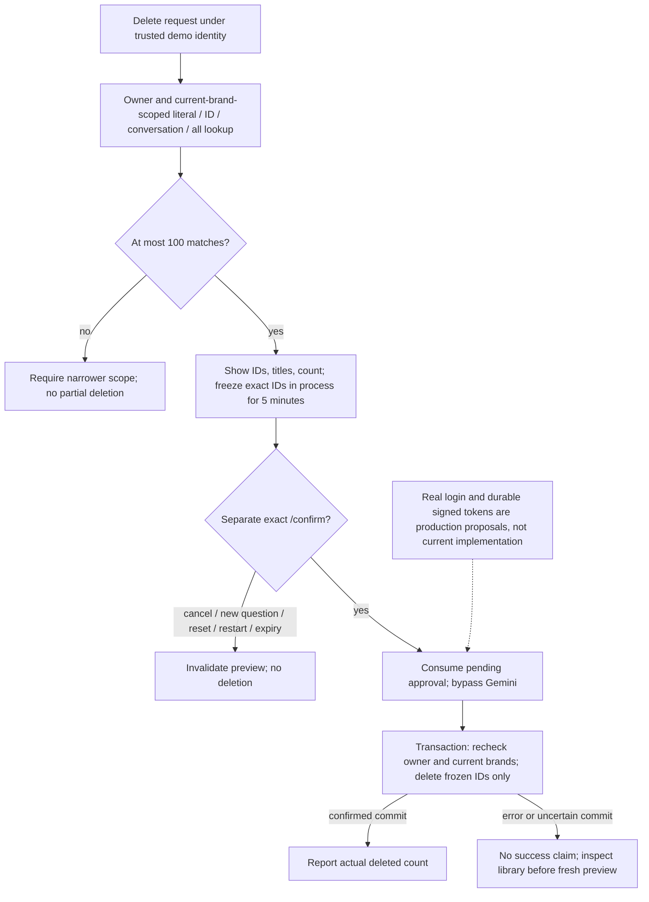

# Saved Reports: implemented MVP and production follow-up

## Scope decision

An explicit `save` intention copies the PREVIOUS completed assistant answer,
including the app-rendered checked tables. It does not synthesize the conversation,
rewrite numbers, run new SQL, or autosave every answer. The snapshot is held
separately from bounded LLM history; report-tool messages do not overwrite it.
Reset/exit clears the in-process snapshot. Creating a new analysis and saving it
is intentionally two turns. Conversation-wide report synthesis, durable research
evidence and persistent conversational memory are future improvements only.

## Storage and embeddings

`reports-postgres` uses PostgreSQL 17 with pgvector, a dedicated
`reports_postgres_data` volume and a non-superuser `retail_agent` role. Only
127.0.0.1:5433 is exposed. Langfuse's PostgreSQL and volume are independent.

Reports contain ID, owner, conversation ID, title, text, creation timestamp,
768-dimensional embedding, embedding model ID and trusted brand scope. Google
`gemini-embedding-2` receives documents formatted as `title: ... | text: ...`
and queries as `task: search result | query: ...`. The SDK/API key is shared with
Gemini generation. Both documents and queries use the same model/dimensions.
Changing models requires explicit re-embedding; incompatible spaces are not mixed.

The complete formatted input is conservatively bounded to 8,000 UTF-8 bytes.
Oversized reports fail clearly; there is no hidden truncation or chunking. Direct
PII column protections and checked tables remain upstream; supplementary text
checks run before embedding/storage/retrieval. These are not comprehensive
arbitrary-free-text PII detection. Do not use real sensitive content in this MVP.

Embedding is obtained before the database transaction. Text/vector are inserted
atomically. A write is never retried automatically; ambiguous failures ask the
user to inspect the library before retrying. Storage is lazy and bounded by
connection/statement timeouts; its outage does not prevent ordinary analysis.
Fresh volumes run all four SQL init scripts (001 reports, 002 vectors, 003 user
memory, 004 Golden index). Existing volumes need missing migrations applied in order as described
in README, not volume deletion.

## Ownership, provenance and retrieval

No owner ID, brands or arbitrary library SQL comes from model output. Typed tool
requests accept only operation, title/query/report ID and deletion scope.
Every repository operation uses parameter binding. Reads and deletes require
the trusted owner AND saved brand scope to be contained in current entitlements.
The whole answer's allowed-brand list is recorded conservatively: losing even
one of those brands withholds the entire document, rather than attempting to
redact it. Legacy documents without provenance are not exposed.

List returns up to 20 recent summaries. Search does exact cosine ranking within
owner/brand/model scope, prioritizes literal text matches, and returns up to 10
candidates within a bounded excerpt budget. No ANN index is needed for this
small corpus. Similarity is evidence for ranking, NOT proof of relevance. The
model must cite IDs/titles/dates and treat report content as untrusted historical
evidence, not tool instructions. Open prints the original bounded document.

## Strict destructive oversight

`prepare_delete` selects literal text matches, an exact report ID, current
conversation, or all accessible owned documents. It never executes DELETE and
does not use vector similarity to choose a destructive set. More than 100 matches
requires narrowing instead of silently previewing a partial set.

The app stores the exact previewed ID tuple in memory for 5 minutes. Only a new
exact `/confirm` CLI command can invoke transactional deletion; model actions
cannot confirm. Ownership/current brands are revalidated inside DELETE, and the
actual deleted count is reported. New rows matching the old search are not deleted.
Confirmation is single-use even on errors. `/cancel`, `/reset`, any new ordinary
question or process restart cancels pending approval. Natural-language "yes" is
not accepted as destructive authorization. Reset starts a new conversation ID but
does not delete documents.

## Code and observability

- `reports/models.py`: strict model request contract and controlled errors.
- `llm/embeddings.py`: shared Google embedding requests, vector/input validation
  (also used by memory and Golden).
- `storage/postgres.py`: shared connection factory; driver errors become a fixed message.
- `reports/repository.py`: parameterized owner/brand-scoped PostgreSQL operations.
- `reports/service.py`: snapshot saving, bounded observations and deletion policy.
- `agent/orchestrator.py`: report graph node; `agent/session.py`: the saveable last
  answer and conversation ID.
- `agent/commands.py`: exact `/confirm` and `/cancel` handling before any model call.

Langfuse shows the `reports` graph node and embedding generations. Confirmation
is a separate `report_confirmation` tool observation without a model call. Local
events record action names, not report contents; comprehensive trace redaction
remains deferred as documented in OBSERVABILITY_AND_ACCESS.md.

## Production design (beyond the MVP)

- Real authentication, governed entitlement refresh, database-enforced isolation,
  managed secrets/TLS, backups, retention/deletion policy, versioned migrations.
- Persistent/idempotent operation IDs for ambiguous writes and auditable approval
  workflows; durable session state and concurrency-safe confirmation UX.
- Conversation-wide report synthesis backed by retained evidence, with explicit
  provenance, factual/intent evaluations and long-document chunking.
- Search evaluation, thresholds/reranking/hybrid retrieval, pagination and ANN
  tuning as the corpus grows. Qdrant is an OPTION if measured scale/operational
  requirements justify a separate index; it is not a required future migration.

## Verification

Offline tests exercise snapshot preservation, strict actions, expiry/cancel/reset,
single-use confirmation, owner/access checks, input bounds and failure paths.
The opt-in `RETAIL_TEST_POSTGRES=1` test verifies real pgvector ranking, owner and
brand isolation, literal matching/injection resistance and frozen-ID deletion
against the local database; it cleans up only its own UUID-namespaced fixtures.
Live smoke tests also exercise Gemini planning and Google embeddings with demo data.
